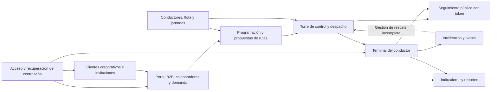
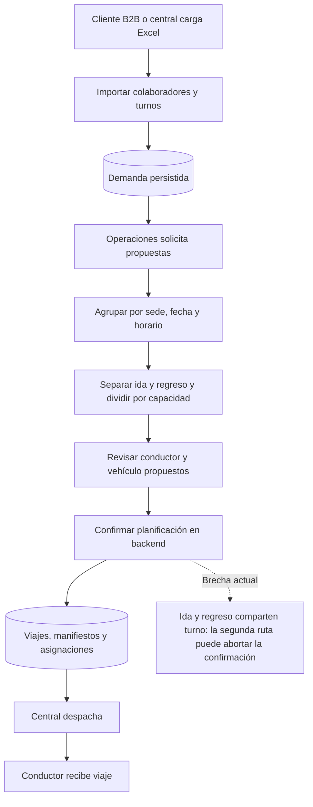
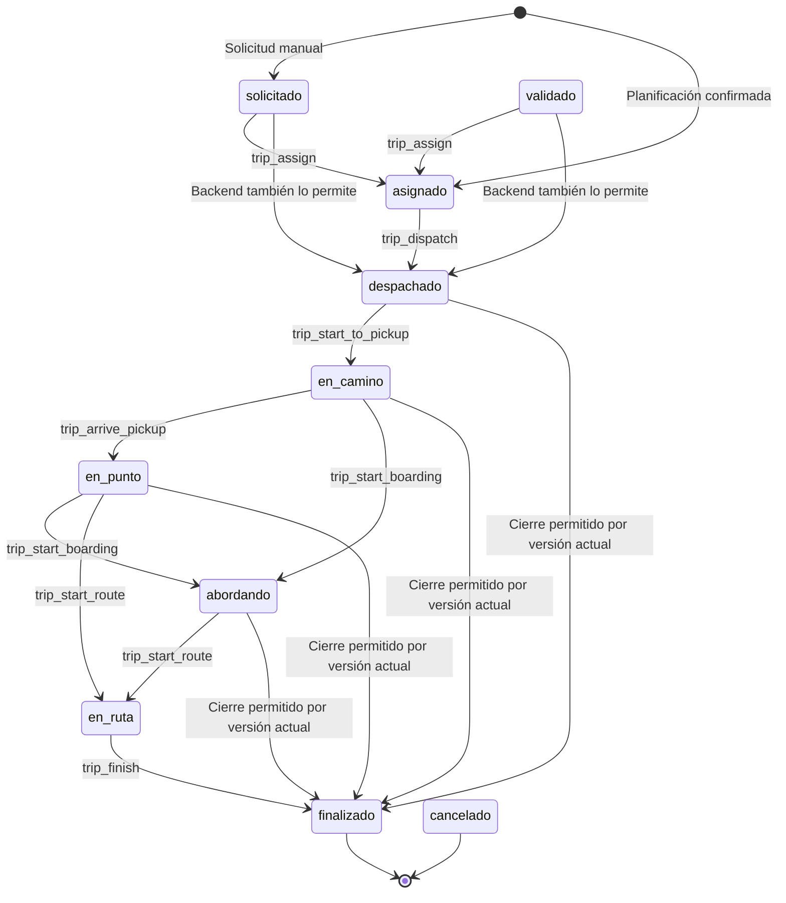
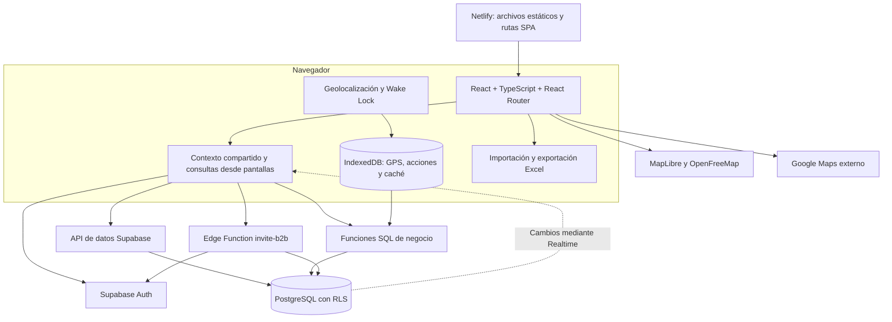
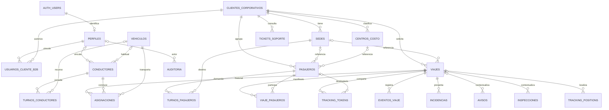

# Radiografía funcional y técnica del sistema

**Proyecto:** Transportes Duet / Neira Transportes.  
**Fecha de revisión:** 14 de octubre de 2026.  
**Alcance:** código del workspace, migraciones versionadas, configuración, pruebas y documentación. No se modificó código funcional ni se aplicaron cambios a bases de datos.

## 1. Visión general

El sistema administra el transporte de personal de **una sola empresa transportista**, cuya interfaz se presenta como **Neira Transportes**. Conecta a la central de operaciones con sus clientes corporativos, conductores y pasajeros.

Su propósito es convertir solicitudes y horarios de colaboradores en viajes, asignar recursos, registrar asistencia y ofrecer seguimiento. Busca centralizar información que, de otro modo, se distribuiría entre planillas, llamadas y mensajes: quién viaja, cuándo, desde dónde, con qué conductor y en qué vehículo.

El modelo vigente es **single-tenant**: los clientes corporativos contratan a la transportista; no son transportistas independientes. La separación de sus datos se basa en `cliente_corporativo_id`. Las referencias históricas a SaaS, tenants y superadministrador no describen el modelo canónico actual.

**Usuarios:** administración, operaciones, despacho, conductores, responsables de clientes corporativos y pasajeros con enlace temporal. Un pasajero puede existir sin cuenta de acceso.

**Diagnóstico general:** existe una aplicación conectada a Supabase con persistencia real y reglas de negocio en PostgreSQL. Sin embargo, convive con acciones locales, valores operacionales predefinidos, inconsistencias entre pantallas y tablas, y brechas de autorización. La presencia de una pantalla o de una declaración «DONE» en documentos anteriores no acredita una funcionalidad completa ni certifica el despliegue actual.

### Cómo leer este documento

- **Implementado:** se encontró código que consulta o guarda datos y su soporte correspondiente en las migraciones. No implica validación en producción.
- **Parcial:** parte del recorrido está implementada, pero faltan conexiones, persistencia o controles.
- **Solo interfaz:** la acción modifica memoria o muestra una confirmación sin completar el proceso anunciado.
- **No verificado:** requiere comprobar infraestructura, configuración o datos fuera del repositorio.

Las conclusiones se basan prioritariamente en el código y en la última definición versionada de cada función SQL. Las referencias **[F1]–[F12]** remiten al inventario de evidencia de la sección 9.

## 2. Módulos y relaciones



| Módulo | Función de negocio y capacidades comprobadas | Estado y límites |
|---|---|---|
| Acceso y cuentas | Inicio de sesión por correo/contraseña, recuperación, aceptación de invitación y cambio de contraseña. Resuelve el perfil para elegir portal. | Implementado con Supabase Auth; existen brechas en la provisión de cuentas y comprobación de permisos. |
| Clientes e invitaciones | Alta de empresas contratantes, datos de contacto, invitación del responsable y generación de enlace de recuperación. | Alta persistente. El editor tarifario no persiste sus valores. No se encontró gestión integral de usuarios internos desde la interfaz. |
| Conductores y flota | Alta, edición y eliminación de recursos; RUT, licencia, contacto, vehículo habitual, capacidad, kilometraje y mantenimiento. | Persistente, con mensajes de éxito prematuros y posible doble alta al invitar conductores. Disponibilidad y telemetría mostradas tienen valores predefinidos. |
| Jornadas de conductores — WFM | Turnos con fecha, horas, vehículo, jornada, estado, notas y horas extras; vistas de lista/matriz, importación Excel y generación por rango. | Persistente. Parte de la generación depende de nombres concretos escritos en código; las restricciones de duplicados y colisiones están principalmente en la interfaz. |
| Programación de servicios | Carga manual de servicios especiales, importación de turnos de pasajeros, generación y revisión de propuestas de ida/regreso. | Parcial. Confirmar utiliza una operación SQL transaccional, pero hay una incompatibilidad al confirmar ambas piernas de un mismo turno. |
| Torre de control | Consulta y filtro de viajes, asignación/reasignación, despacho y copia de enlaces de seguimiento. Incluye un mapa de flota. | Asignación y despacho usan funciones SQL. El mapa no consume las posiciones GPS reales guardadas. |
| Portal B2B | Ocho vistas: inicio, colaboradores, turnos y horarios, solicitud de viaje, servicios, indicadores, reportes y soporte. Importa nómina/turnos y exporta Excel. | Varias operaciones persisten. Algunas entradas del formulario se descartan; los indicadores y reportes tienen discrepancias semánticas. |
| Terminal del conductor | Consulta viajes activos asignados, manifiesto, abordaje/ausencia/reversión, finalización, navegación externa y reporte de incidencias. | Persistencia de abordajes y cierre mediante funciones SQL. No conecta las acciones a la cola offline ni expone el recorrido completo de estados. |
| Seguimiento del pasajero | Ruta pública `/live-track/:token`; estado, conductor, vehículo y hora de última posición, consultados cada 15 segundos. | Implementado mediante token temporal. La pantalla no dibuja mapa ni calcula ETA, aunque la respuesta SQL contiene coordenadas. |
| Incidencias, avisos y rescate | El conductor intenta guardar incidencias y avisos; la central muestra una vista de excepciones y selección de reemplazo. | Parcial: no se cargan las incidencias a esa vista; confirmar rescate solo muestra una alerta. |
| Indicadores y trazabilidad | Contadores SQL de operación y B2B, exportaciones Excel, eventos de viaje y auditoría de cambios. | Los contadores SQL son reales; «puntualidad», ausentismo y distribución de costos de algunas vistas no corresponden a mediciones completas. Auditoría automática limitada a perfiles y viajes. |

**Fuentes:** [F1], [F2], [F3], [F4], [F5], [F6], [F7], [F8].

## 3. Flujos operacionales

### 3.1 Preparación de la operación y acceso

1. Administración registra el cliente corporativo y sus datos de contacto.
2. Desde Clientes puede invitar al contacto mediante `invite-b2b`. La función crea o reutiliza una cuenta de Auth, actualiza el perfil y trata de vincularlo al cliente.
3. El destinatario establece su contraseña a través del enlace y accede al portal B2B.
4. La central mantiene conductores, vehículos y jornadas. El vehículo habitual y el del turno son asociaciones distintas de la asignación a un viaje.

La función de invitación devuelve si envió correo y también puede entregar un enlace. Crear la cuenta no garantiza que el correo haya sido entregado ni que todas las vinculaciones hayan finalizado: algunos errores se registran sin abortar. No hay una transacción única que abarque Auth, perfil y recursos. [F2], [F3], [F4]

### 3.2 Demanda recurrente: de la planilla al despacho



La importación `import_b2b_shifts` busca al pasajero por RUT dentro del cliente y lo crea o actualiza. Resuelve sede por identificador o nombre, admite formatos de fecha y crea el turno. Para B2B utiliza la empresa asociada a la cuenta, no una empresa libremente elegida en el archivo.

La planificación es una **propuesta básica de agrupación**, no un optimizador geográfico: agrupa por sede/fecha y hora exacta de entrada o salida; divide por capacidad; elige un vehículo que soporte el grupo y rota conductores activos. No calcula tiempos de trayecto, cercanía, descansos ni solapamientos. El geocodificador se instancia, pero el planificador no lo utiliza; conserva coordenadas existentes o coloca cero.

La hora de entrada representa el horario objetivo del colaborador en su lugar de trabajo, pero el planificador la utiliza directamente como hora programada del viaje de ida. No descuenta anticipación para recoger pasajeros.

**Incompatibilidad comprobada por lectura:** el planificador genera ida y regreso con los mismos identificadores de turno. `create_planned_trips` exige que cada turno esté `programado` y lo cambia a `asignado` al procesar la primera ruta. Al procesar la segunda, lanza una excepción. Al ser una llamada transaccional, se revierte ese conjunto de inserciones. [F5], [F6]

### 3.3 Solicitud manual u ocasional

La central o el cliente B2B ingresa pasajero, teléfono, origen, destino y programación. `crearViaje` guarda un viaje `especial` en estado `solicitado`, crea un nuevo pasajero y luego lo vincula al manifiesto.

Estos son **tres pasos independientes desde el navegador**. Si falla el segundo o tercero, el viaje ya puede existir. Además, no reutiliza necesariamente al colaborador seleccionado de la nómina: crea un registro con RUT sintético. El monto estimado se guarda dentro de `observaciones` como texto JSON; no proviene de un motor tarifario.

Después, la torre elige conductor, resuelve un vehículo y llama primero a `trip_assign` y luego a `trip_dispatch`. Cada llamada es independiente: si falla despacho, la asignación previa permanece. La selección puede recurrir al primer vehículo disponible o incluso al primero de la lista. [F2], [F3], [F7]

### 3.4 Ejecución del viaje y estados



El diagrama muestra los caminos principales de las funciones SQL versionadas, no una secuencia obligatoria de botones. Existe `trip_cancel` para que la central cancele un viaje no terminal y sus asignaciones, pero no se encontró una llamada desde las pantallas actuales. El estado `validado` existe sin una acción específica de validación conectada. También se admiten `incidencia` y `rescate_solicitado` en la tabla, sin un flujo completo que los gestione.

En el terminal actual:

1. Se identifica al conductor por su perfil o correo.
2. Se consultan viajes con asignación activa y estados entre despachado y en ruta. No se filtran exclusivamente los del día; se ordenan por fecha y el primero queda activo.
3. Se muestran pasajeros pendientes y se permite registrar «a bordo», «ausente» o revertir a pendiente mediante `board_passenger`.
4. Se puede abrir Google Maps con coordenadas o dirección.
5. La pantalla exige que no queden pasajeros pendientes para finalizar.
6. `trip_finish` guarda el cierre y un evento; un trigger intenta completar los turnos asociados por pasajero.

**Límites:** no se encontraron llamadas desde el terminal a las funciones de inicio, llegada y comienzo de ruta. La última versión de `trip_finish` no verifica pasajeros pendientes y acepta estados previos muy amplios; `board_passenger` tampoco comprueba que el viaje siga abierto. Por ello, el bloqueo visual de cierre no constituye una regla obligatoria de backend. [F3], [F7]

### 3.5 Seguimiento y conectividad

```mermaid
sequenceDiagram
    participant C as Central
    participant DB as Supabase / PostgreSQL
    participant D as Navegador del conductor
    participant Q as IndexedDB local
    participant P as Pasajero
    C->>DB: Generar token de viaje
    DB-->>C: Token original; hash guardado con vencimiento
    C-->>P: Compartir enlace copiado manualmente
    D->>Q: Guardar punto GPS, aproximadamente cada 15 s
    D->>DB: Enviar lote GPS si hay conexión
    loop Cada 15 segundos
        P->>DB: Consultar información pública con token
        DB-->>P: Estado, conductor, vehículo y última posición
    end
    Note over D,Q: Abordajes y cierre actuales no usan la cola de acciones
```

El GPS usa la geolocalización del navegador y solicita mantener la pantalla encendida cuando la API del dispositivo lo permite. Los puntos se guardan localmente y se envían en lotes. Esto requiere permiso de ubicación; no acredita seguimiento nativo en segundo plano.

El enlace público caduca a las 24 horas según la función vigente. Al regenerarlo se revocan tokens anteriores de la misma pareja viaje/pasajero. **No se encontró revocación automática al finalizar el viaje**, pese a afirmaciones en documentación anterior. No se encontró integración que envíe SMS; la torre copia el enlace al portapapeles.

Existe infraestructura de cola para acciones y caché de viajes, pero los abordajes y cierres actuales llaman directamente a Supabase; el caché no se utiliza desde el terminal. La continuidad operacional sin conexión es, por tanto, parcial. [F3], [F8]

### 3.6 Incidencias y soporte

El conductor puede seleccionar un tipo de incidencia. El terminal intenta insertar un registro y enviar un aviso, pero no comprueba el resultado de la inserción antes de anunciar éxito. La pantalla de incidencias de la central deriva sus casos del estado/objeto de los viajes, sin consultar la tabla `incidencias`; por eso un registro guardado puede no aparecer allí.

Confirmar un rescate no reasigna conductor ni vehículo, no cambia la unidad a mantenimiento y no renueva un token: solo muestra una alerta. Por otra parte, el B2B puede crear y consultar tickets de soporte; no se encontró una bandeja interna que complete su atención ni una notificación externa al ejecutivo. [F2], [F3], [F4]

## 4. Roles y permisos reales

La aplicación tiene cinco roles autenticados y acceso público por token. Las pantallas de ADMIN, OPERACIONES y DISPATCHER comparten el mismo portal; eso no significa que todas sus acciones estén autorizadas de igual manera en PostgreSQL.

| Actor | Acceso implementado en políticas y funciones | Restricciones y diferencias relevantes |
|---|---|---|
| ADMIN | Administración de perfiles/clientes, gestión de recursos y viajes, planificación, invitaciones desde UI, indicadores y consulta de auditoría. | Abrir el terminal de conductor no le concede permiso para ejecutar las funciones reservadas a CONDUCTOR. |
| OPERACIONES | Gestión de clientes, sedes, centros de costo, pasajeros, flota, jornadas y operación de viajes; importación y confirmación de planificación; indicadores y tickets. | En `perfiles` tiene lectura general, no la administración de roles que algunos documentos sugieren. No tiene consulta general de auditoría. |
| DISPATCHER | Gestión de conductores, vehículos, jornadas, viajes y asignaciones; despacho, cancelación y generación de tokens. Lectura de clientes, pasajeros y turnos. | No puede confirmar planificación ni consultar `get_admin_kpis`. El portal compartido muestra acciones que pueden fallar por permiso. |
| CONDUCTOR | Lectura de sus recursos/viajes relacionados, manifiesto y jornadas; funciones de abordaje, cierre y GPS con asignación activa; inserción de incidencias. | Varias políticas de lectura consideran cualquier asignación histórica, sin exigir que siga activa. Su modificación directa de `conductores` no está habilitada por las políticas revisadas. |
| CLIENTE_B2B | Lectura de su cliente y viajes; lectura/alta/edición de pasajeros, sedes y centros de costo propios; importación de turnos mediante función; reservas solicitadas y tickets propios. | No tiene asignación/despacho ni roles. La consulta de asignaciones no cuenta con política B2B, lo que puede dejar conductor/vehículo vacíos en servicios. No se halló CRUD visual completo de sedes/centros. |
| PASAJERO | Consulta pública mediante token de una proyección del viaje. | Sin sesión necesaria, sin acceso directo a tablas y sin acciones operacionales en su pantalla. |

### Qué controles existen y dónde hay brechas

**Controles presentes:** RLS en tablas operacionales, funciones de resolución de identidad, validación de rol/asignación en varias funciones, revocación del acceso anónimo directo a tablas, hashes y expiración de tokens. El router exige sesión y el contexto rechaza perfiles ausentes o inactivos. [F1], [F2], [F7], [F8]

**Brechas verificables en el código, cuya exposición efectiva depende del despliegue:**

1. **Invitaciones privilegiadas sin autorización del solicitante.** `supabase/functions/invite-b2b/index.ts` usa `service_role`, acepta los cinco roles en el cuerpo y modifica perfiles existentes, pero no valida quién llama ni su rol. Una eventual validación de JWT en la plataforma no reemplaza esa autorización. No se probó explotación remota.
2. **Rol tomado de metadatos al crear usuarios.** La última versión de `handle_new_user` toma `raw_user_meta_data.rol` y puede activar un perfil ADMIN. La configuración local permite registro de usuarios. Esto es incompatible con una provisión de roles exclusivamente administrativa si esa combinación llega al entorno desplegado.
3. **El estado inactivo no se comprueba de forma general en backend.** `get_auth_rol` consulta el rol sin filtrar `perfiles.estado`; el rechazo del frontend no demuestra bloqueo de solicitudes directas con una sesión válida.
4. **Reglas de viaje eludibles mediante escritura directa.** Los roles internos disponen de políticas amplias de modificación de viajes/asignaciones; el conductor tiene actualización directa del manifiesto. No se encontró un trigger general que obligue a pasar por la máquina de estados. Los eventos no son inmutables para todos los roles internos, pues también tienen políticas de escritura.
5. **Integridad entre clientes incompleta.** La inserción B2B del manifiesto comprueba la empresa del viaje, pero no la del pasajero referenciado. La planificación privilegiada tampoco valida exhaustivamente que cada pasajero, turno y sede corresponda a la misma empresa. Las claves foráneas individuales no garantizan esa consistencia.
6. **Exposición pública mayor que la pantalla.** La función pública devuelve teléfono del conductor y direcciones del viaje, además de coordenadas. La pantalla no presenta todos esos campos, pero un consumidor de la respuesta puede recibirlos. No se encontró limpieza automática de GPS ni limitación de solicitudes específica en el código revisado.

Estas observaciones impiden afirmar que el aislamiento y el mínimo privilegio estén completamente garantizados solo por la existencia de RLS. [F4], [F6], [F7], [F8]

## 5. Arquitectura y tecnologías



| Capa | Implementación observada |
|---|---|
| Interfaz | React 19, TypeScript, React Router 7, Tailwind CSS 3 y estilos CSS; iconos Lucide. |
| Construcción | Vite 8. Scripts de desarrollo, lint, tipos, pruebas y build en `web-portal/package.json`. |
| Estado y acceso a datos | `AppContext` centraliza sesión y listas compartidas. Los componentes también consultan y modifican Supabase directamente; no hay una capa uniforme de servicios. |
| Backend | Supabase Auth, API de tablas, funciones PostgreSQL invocadas como RPC y una función Edge escrita para Deno. No se encontró servidor de aplicación propio. |
| Persistencia | PostgreSQL como almacenamiento operacional; claves foráneas, restricciones, políticas RLS y triggers. IndexedDB almacena datos locales de apoyo. |
| Actualizaciones | Suscripciones a avisos, conductores, vehículos, viajes y asignaciones; indicadores por consulta cada 30 segundos y tracking público cada 15. |
| Mapas y navegación | Mapa de central con MapLibre/OpenFreeMap y enlaces a Google Maps. Hay un adaptador Nominatim no utilizado efectivamente por el planificador. |
| Archivos | `xlsx` procesa planillas en el navegador. No se encontró almacenamiento de adjuntos o evidencias mediante Supabase Storage. |
| Entrega | Netlify publica `web-portal/dist` y redirige las rutas al HTML de la SPA. Configura HTTPS y encabezados básicos. GitHub Actions ejecuta controles frontend. |

**Estructura:** `web-portal/` contiene la aplicación; `supabase/` contiene el modelo canónico, funciones, seed y pruebas; `backend/supabase/` conserva otro modelo y otra copia de invitaciones que no deben confundirse con el esquema canónico. `docs/` reúne documentos de distintas etapas. [F1], [F4], [F9], [F10]

**Persistencia tras recarga:** las operaciones aceptadas por Supabase vuelven a consultarse y pueden recuperarse. Esto no aplica al checklist, rescate, tarifas locales ni otros cambios que solo alteran memoria. La interfaz no dispone de un estado uniforme de carga/error para todas las consultas: varias ignoran el error del SDK y pueden aparentar datos vacíos o antiguos.

**Realtime:** existen suscripciones en frontend, pero no se encontró en las migraciones una configuración explícita de publicación de las tablas. Su funcionamiento efectivo depende de la configuración remota y no quedó acreditado por esta revisión.

**Configuración:** el cliente exige `VITE_SUPABASE_URL` y `VITE_SUPABASE_ANON_KEY`; la función Edge necesita variables privadas del servidor. No se inspeccionaron valores secretos ni se modificó configuración de los servicios.

## 6. Modelo de datos

El esquema canónico parte de 18 tablas y las migraciones agregan `turnos_pasajeros`, `turnos_conductores` y `tickets_soporte`: **21 tablas de negocio declaradas en ese historial**, además de las propias de Supabase. No se realizó inventario de la base remota.



El diagrama destaca relaciones principales; no enumera todos los campos ni las relaciones de autor/remitente. El enlace `AUTH_USERS → PERFILES` representa la asociación utilizada por la aplicación: `auth_user_id` es único, pero el DDL canónico no lo declara como clave foránea a `auth.users`.

| Entidades | Información y papel operacional |
|---|---|
| `perfiles`, `usuarios_cliente_b2b` | Identidad de negocio, rol/estado y vínculo entre usuario del portal y cliente. Una cuenta B2B no es un pasajero. |
| `clientes_corporativos`, `sedes`, `centros_costo` | Empresa contratante, destinos organizacionales y clasificación del gasto/personal. |
| `pasajeros`, `turnos_pasajeros` | Colaboradores y demanda de transporte por fecha, entrada/salida y dirección. RUT único dentro del cliente. |
| `conductores`, `vehiculos`, `turnos_conductores` | Recursos operacionales y jornadas; el conductor puede existir sin perfil vinculado. La jornada tiene vehículo opcional y horas extras. |
| `viajes`, `viaje_pasajeros` | Servicio programado y relación de participantes con estado de asistencia, orden, ubicación de parada y hora de abordaje. |
| `asignaciones` | Historial conductor/vehículo por viaje. Un índice parcial limita a una asignación activa por viaje; no impide usar el mismo recurso en viajes simultáneos. |
| `eventos_viaje`, `auditoria` | Eventos registrados por funciones del motor y auditoría de cambios de perfiles/viajes. No son una auditoría integral de todas las entidades. |
| `incidencias`, `avisos`, `inspecciones` | Problemas del viaje, mensajes y estructura de inspección. Tener la tabla de inspecciones no significa que el checklist de la pantalla la use. |
| `tracking_positions`, `tracking_tokens` | Historial GPS por viaje/conductor y acceso público mediante hash, expiración y revocación. |
| `tickets_soporte` | Requerimientos del cliente con asunto, detalle, estado, prioridad y ejecutivo. |

### Límites del modelo que afectan al negocio

- **Turno sin vínculo preciso con su viaje:** el manifiesto no conserva `turno_id`. El trigger de cierre completa todos los turnos `asignado` del pasajero encontrado, sin filtrar fecha o sede. Podría cerrar demanda de otros servicios del mismo colaborador.
- **Ida y regreso sin avance independiente:** el único estado del turno no representa ambas piernas, origen de la incompatibilidad de planificación descrita.
- **Un usuario B2B puede tener varias relaciones:** la tabla permite varios clientes por perfil, pero los helpers y el contexto seleccionan uno con `LIMIT 1`, sin selección estable de empresa. La operación normal presupone una sola asociación.
- **Tarifas y montos:** no se encontraron columnas tarifarias en el historial canónico ni entidades de factura/pago. El precio manual queda embebido en observaciones. No hay evidencia de liquidación o facturación automática.
- **Borrado:** se usan restricciones para varias relaciones operacionales y `SET NULL` para algunas opcionales. También hay cascadas concretas, por ejemplo jornadas al borrar conductor y tickets al borrar cliente; no existe una política única de borrado lógico.

**Fuentes:** [F2], [F6], [F7], [F8].

## 7. Estado actual e inconsistencias prioritarias

### 7.1 Capacidades con soporte real

Hay integración efectiva de sesión/perfil, catálogos, viajes, manifiestos, asignaciones, importación de turnos, jornadas, tickets, funciones de abordaje/cierre, recepción GPS y tokens de tracking. Las funciones SQL emplean transacciones y, en varios casos, bloqueos de filas. Algunas operaciones tienen tolerancia a repetir el mismo estado; no existe una estrategia general de idempotencia con claves para todo el sistema.

### 7.2 Brechas funcionales y técnicas

| Prioridad | Hallazgo comprobado | Consecuencia práctica | Evidencia |
|---|---|---|---|
| Crítica | Invitación con privilegios sin autorización del solicitante; trigger de alta acepta rol de metadatos. | Posible creación o reasignación indebida de privilegios si se despliega esta implementación accesible. | [F4], [F7] |
| Alta | Propuestas de ida/regreso reutilizan el turno y la confirmación lo consume una sola vez. | La confirmación conjunta puede fallar y revertirse. | [F5], [F6] |
| Alta | Checklist solo usa estado React; rescate solo muestra una alerta. | Se anuncia una operación que no queda registrada ni ejecutada; se pierde al recargar. | [F3] |
| Alta | El editor tarifario llama a `actualizarCliente`, que no mapea `tarifario` a campos SQL. | Puede aparecer éxito y actualizarse la memoria, pero las tarifas se pierden al recargar. | [F2], [F3] |
| Alta | Abordajes y cierre no usan `queueAction`; caché de viajes sin consumidores. | No se garantiza registrar acciones ni recuperar manifiestos al perder conexión. | [F3], [F8] |
| Alta | Sin comprobación backend del manifiesto completo antes de finalizar; políticas permiten escrituras directas amplias. | Se pueden producir cierres o cambios fuera del proceso visual previsto. | [F7] |
| Alta | Mapa de central utiliza coordenadas fijas del mapeo de conductores, no `tracking_positions`. | Los marcadores no acreditan la posición real de la flota. | [F2], [F3] |
| Alta | El contexto no carga incidencias y la vista espera incidencias dentro de cada viaje. | El tablero puede indicar cero alertas mientras existen incidencias guardadas; el contador SQL puede discrepar. | [F2], [F3], [F7] |
| Alta | Alta manual de viaje en varios pasos; errores capturados sin propagarse al formulario. | Registros parciales y confirmaciones de éxito aunque falló la operación. | [F2], [F3] |
| Alta | La función Edge puede crear el conductor y luego el contexto vuelve a insertarlo. | RUT duplicado o alta aparentemente fallida tras haber creado cuenta/perfil/conductor. | [F2], [F4] |
| Media | Despacho valida existencia del recurso, pero no capacidad, licencia, actividad ni solapamiento; la planificación solo valida parte de ello. | Asignaciones no aptas o simultáneas. Las jornadas no gobiernan realmente la asignación de viajes. | [F3], [F6], [F7] |
| Media | La generación WFM contiene reglas por nombres concretos; la creación no envía `horas_extras`, aunque la edición sí. | Reglas difíciles de mantener y pérdida del valor inicial de horas extras. | [F2], [F3] |
| Media | «SLA» se calcula por estados despachados/finalizados; «cumplimiento» por no cancelados; costos por palabras del origen. | No son medidas reales de puntualidad, finalización o gasto por centro de costo; sin viajes puede mostrarse 100 %. | [F3] |
| Media | Ausentismo/exportaciones consultan `turnos.presente`, inexistente en las migraciones; algunos reportes esperan `completado` en viajes, cuyo terminal es `finalizado`. | Asistencia pendiente o evaluaciones incorrectas pese a abordajes registrados. | [F3], [F6], [F7] |
| Media | La pantalla B2B solicita centro de costo, área, comuna y preferencia de turno, pero el alta no los guarda. | Datos ingresados desaparecen tras recarga; reportes no pueden utilizarlos como clasificación real. | [F3] |
| Media | Avisos creados con identificador local distinto del UUID guardado y sin remitente/destinatario. | Marcar como leído puede fallar hasta recargar; el conductor puede no poder leer el aviso insertado por su política de acceso. | [F2], [F7] |
| Media | No hay recuperación de errores uniforme; algunos cambios locales se aplican incluso tras error. | La pantalla puede divergir de la base y mostrar éxitos no confirmados. | [F2], [F3] |

### 7.3 Funcionalidades anunciadas sin implementación completa encontrada

No se encontró evidencia de una aplicación Android descargable, instalación PWA con manifest/service worker, SMS automáticos, ETA calculada, notificación externa de tickets, reasignación de rescate completa, facturación, pagos o liquidaciones. El asistente de voz del conductor cambia texto temporalmente; no se encontró síntesis de voz en esa acción. La página pública tampoco ofrece acciones del pasajero.

Hay valores operacionales predefinidos para coordenadas, importes, teléfonos de respaldo, puntuación del conductor, horas conducidas, sugerencias de direcciones y contactos de soporte. Algunos ejemplos están apropiadamente en plantillas/seed; otros se utilizan como datos durante operaciones reales. Deben distinguirse de datos confirmados por el usuario o por la base.

### 7.4 Coherencia del repositorio y del despliegue

- El `README.md` describe control multiempresa y un administrador SaaS que no existen en el modelo canónico. Conserva referencias a scripts SQL de una carpeta `database/` no presente.
- `backend/supabase/` contiene un esquema antiguo incompatible y otra implementación de `invite-b2b`. El historial relevante actual está en `supabase/migrations/`; no deben combinarse ambas líneas como si fueran acumulativas.
- `supabase/seed.sql` utiliza nombres de columnas previos a su renombrado. Un reset con el seed vigente fallaría contra el esquema final; no se ejecutó un reset para comprobarlo porque alteraría datos.
- Los tipos generados conviven con alias permisivos y abundante `any`; TypeScript tiene `strict: false`. Que el chequeo pase no valida la correspondencia entre campos de pantalla y base de datos.
- La CI usa Node 20 y Netlify Node 22. La CI exige `npm ci` y un lockfile, pero Git ignora `package-lock.json` y no hay lockfiles versionados. Esto limita la reproducibilidad del pipeline tal como está almacenado.
- Existe un script auxiliar de restablecimiento con contraseña literal; no se reproduce aquí ni se ejecutó. No forma parte del bundle por el solo hecho de existir, pero contradice el manejo de secretos esperado.
- Los documentos de certificación y checklist contienen afirmaciones de etapas anteriores. No se verificaron sus despliegues, respaldos, permisos remotos, planes contratados ni supuesta sincronización DEV/PROD.

**Fuentes:** [F9], [F10], [F11], [F12].

## 8. Validación realizada y límites

Se ejecutaron controles locales en `web-portal/` con las dependencias ya disponibles. No se instalaron paquetes ni se modificó código para hacerlos pasar.

| Control | Resultado de esta revisión |
|---|---|
| `npm run lint` | Correcto, código de salida 0, con advertencias de variables/importaciones sin uso y dependencias de hooks. |
| `npm run typecheck` | Correcto, código de salida 0. La configuración no es estricta. |
| `npm run test` | Correcto: un archivo, seis pruebas del planificador. |
| `npm run build` | Correcto. Advertencia por bundle grande: JavaScript principal de aproximadamente 2,24 MB minificado, 624 kB comprimido. |
| `npm run test:e2e -- --reporter=line --output=../tmp/analysis-e2e` | Fallo observado en tracking público: esperaba «No autorizado» y la pantalla mostró «Seguimiento no disponible». También se registró `Failed to fetch` al consultar Supabase. La ejecución no finalizó y se interrumpió; no se obtuvo un resumen consolidado de los cinco casos. |
| Pruebas DB/RLS | No ejecutadas: `DATABASE_URL` no está configurada en la sesión y no se alteró ninguna base remota. |

**Cobertura disponible:** seis casos unitarios de agrupación/capacidad; cinco casos de navegador para acceso y portales; siete archivos SQL para RLS, motor, conductor, tracking, B2B, planificación e indicadores. Los casos autenticados de navegador se omiten si no reciben credenciales.

Las pruebas SQL no equivalen a una certificación vigente: varios fixtures utilizan columnas que ya no existen y UUID con caracteres no hexadecimales. También hay expectativas de permisos y estados anteriores. El seed y estos fixtures requieren reconciliación antes de poder usarlos para acreditar el esquema final. Las pruebas unitarias actuales verifican la generación de rutas, pero no su confirmación conjunta en SQL, por lo que no detectan el conflicto ida/regreso.

No se validaron viajes reales completos, refresco por cada rol contra una instancia controlada, funcionamiento offline en dispositivo, entrega de correos, geolocalización física, publicación Realtime ni infraestructura productiva. Los hallazgos de seguridad son de revisión estática y no incluyen intentos de explotación.

## 9. Inventario de evidencia y prioridades de continuidad

Las rutas siguientes son relativas a la raíz del proyecto y permiten profundizar sin recorrer todo el repositorio nuevamente.

| Referencia | Código o configuración revisada |
|---|---|
| **F1** | [Rutas y selección de portales](web-portal/src/App.tsx), [navegación](web-portal/src/components/Navbar.tsx), [pantallas de autenticación](web-portal/src/components/auth/). |
| **F2** | [Contexto, carga y escritura de datos](web-portal/src/context/AppContext.tsx), especialmente `syncFromSupabase`, `crearViaje`, `agregarConductor`, `actualizarCliente` y jornadas. |
| **F3** | [Portal operacional y sus vistas](web-portal/src/components/tenantadmin/), [terminal del conductor](web-portal/src/components/conductor/ConductorApp.tsx), [portal B2B](web-portal/src/components/b2b/ClientPortalB2B.tsx). |
| **F4** | [Función Edge de invitación vigente](supabase/functions/invite-b2b/index.ts) y [copia histórica](backend/supabase/functions/invite-b2b/index.ts). |
| **F5** | [Planificador](web-portal/src/lib/routePlanner.ts), [pantalla de programación](web-portal/src/components/tenantadmin/ProgramacionServiciosView.tsx), [pruebas unitarias](web-portal/src/lib/routePlanner.test.ts). |
| **F6** | [Demanda B2B](supabase/migrations/20260812070000_b2b_operations.sql), [confirmación de rutas](supabase/migrations/20260812080000_route_planning.sql), [jornadas e importación actual](supabase/migrations/20260902000000_driver_shifts_and_vehicle_coupling.sql), [sincronización y auditoría](supabase/migrations/20260831000000_productization_fixes.sql). |
| **F7** | [Esquema canónico](supabase/migrations/20260812024733_canonical_schema.sql), [RLS](supabase/migrations/20260812032628_rls_security.sql), [motor de viajes](supabase/migrations/20260812040000_trip_engine.sql), [última asignación/despacho](supabase/migrations/20260812140000_fix_dispatch_tracking_vehiculos.sql), [últimos abordajes y cierre](supabase/migrations/20260910000001_fix_driver_actions.sql), [trigger de alta](supabase/migrations/20260909030000_smart_b2b_trigger_and_fix.sql), [tickets y reservas B2B](supabase/migrations/20260909050000_b2b_phase1_tickets_and_rls.sql), [KPIs](supabase/migrations/20260812090000_kpis.sql). |
| **F8** | [GPS](web-portal/src/hooks/useDriverGPS.ts), [colas locales](web-portal/src/lib/offlineQueue.ts), [seguimiento público](web-portal/src/components/pasajero/LiveTrackView.tsx), [RPC GPS](supabase/migrations/20260812050000_driver_ops.sql), [última función pública de tracking](supabase/migrations/20260812140000_fix_dispatch_tracking_vehiculos.sql), [revocación de grants anónimos](supabase/migrations/20260812120000_security_grants_fix.sql). |
| **F9** | [Dependencias y scripts frontend](web-portal/package.json), [configuración de tipos](web-portal/tsconfig.app.json), [tipos de interfaz](web-portal/src/types/index.ts), [cliente Supabase](web-portal/src/lib/supabase.ts), [Netlify](netlify.toml), [CI](.github/workflows/ci.yml), [configuración Supabase](supabase/config.toml), [.gitignore](.gitignore). |
| **F10** | [README histórico](README.md), [arquitectura documentada](docs/DATABASE_ARCHITECTURE.md), [seguridad documentada](docs/SECURITY_MODEL.md), [roadmap](docs/ROADMAP.md), [certificación previa](docs/PRODUCTION_CERTIFICATION.md), [operaciones](docs/OPERATIONS.md), [checklist](docs/GO_LIVE_CHECKLIST.md), [modelo histórico](backend/supabase/migrations/20260802000000_initial_wfm_schema.sql). |
| **F11** | [Pruebas de navegador](web-portal/e2e/), [configuración Playwright](web-portal/playwright.config.ts), [pruebas SQL y runner](supabase/tests/database/), [seed canónico](supabase/seed.sql). |
| **F12** | [Script auxiliar de restablecimiento](supabase/scripts/force_set_password.js), [sincronización de esquema B2B](supabase/migrations/20260812110000_b2b_schema_sync.sql), [vehículo de jornada y email](supabase/migrations/20260903000000_wfm_vehiculo_turnos_email.sql), [horas extras](supabase/migrations/20260916000000_add_horas_extras_turnos.sql). |

**Orden sugerido para continuar, sin implementar cambios en esta revisión:**

1. Cerrar la autorización de invitaciones y la asignación de roles; verificar RLS y usuarios inactivos contra un entorno controlado.
2. Reconciliar turno, ida/regreso y manifiesto, y completar reglas obligatorias de cierre/asignación en backend.
3. Completar persistencia de checklist, tarifas, incidencias y rescates, con confirmaciones que reflejen el resultado real.
4. Conectar las acciones del conductor al almacenamiento offline, con idempotencia, aislamiento de la cola por usuario y manejo explícito de conflictos.
5. Conectar mapas a GPS real, corregir indicadores y reportes, y alinear seed, pruebas, tipos y documentación.

La base del producto está construida, pero el recorrido operacional completo aún requiere esas correcciones y validación por rol antes de considerarlo acreditado para una operación crítica.
